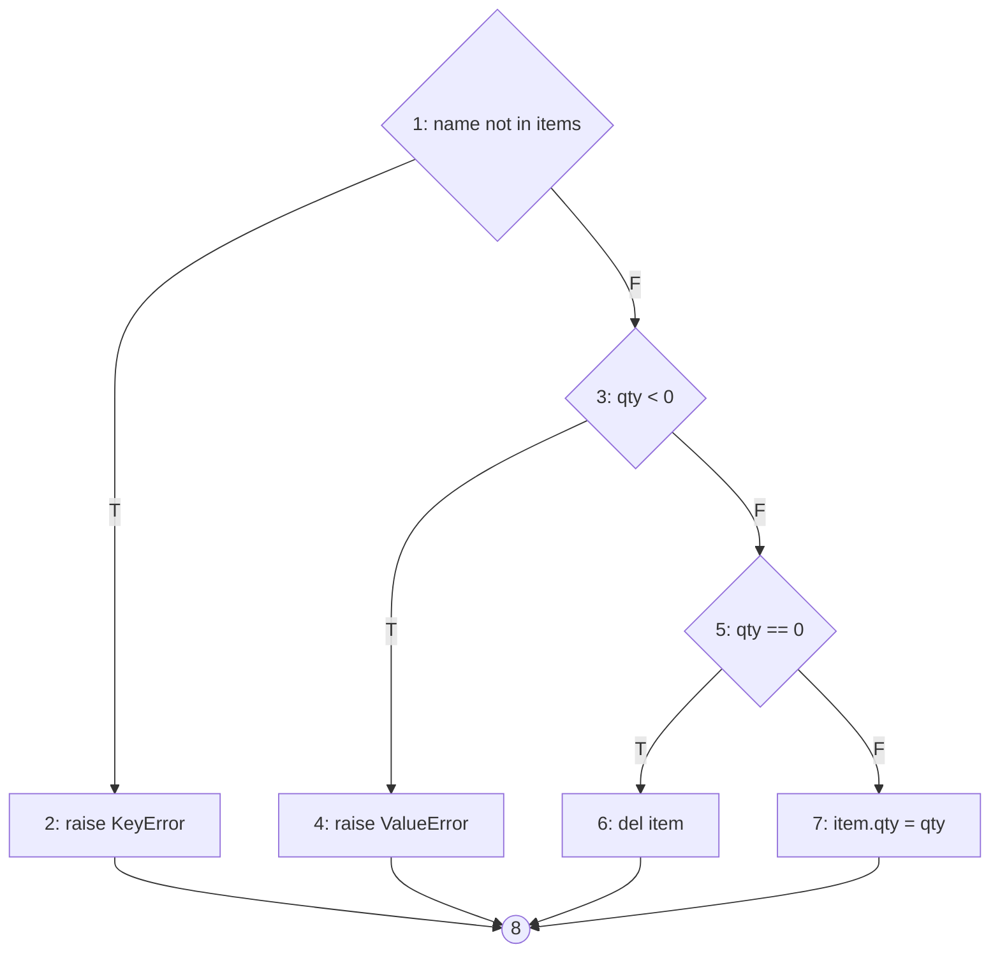
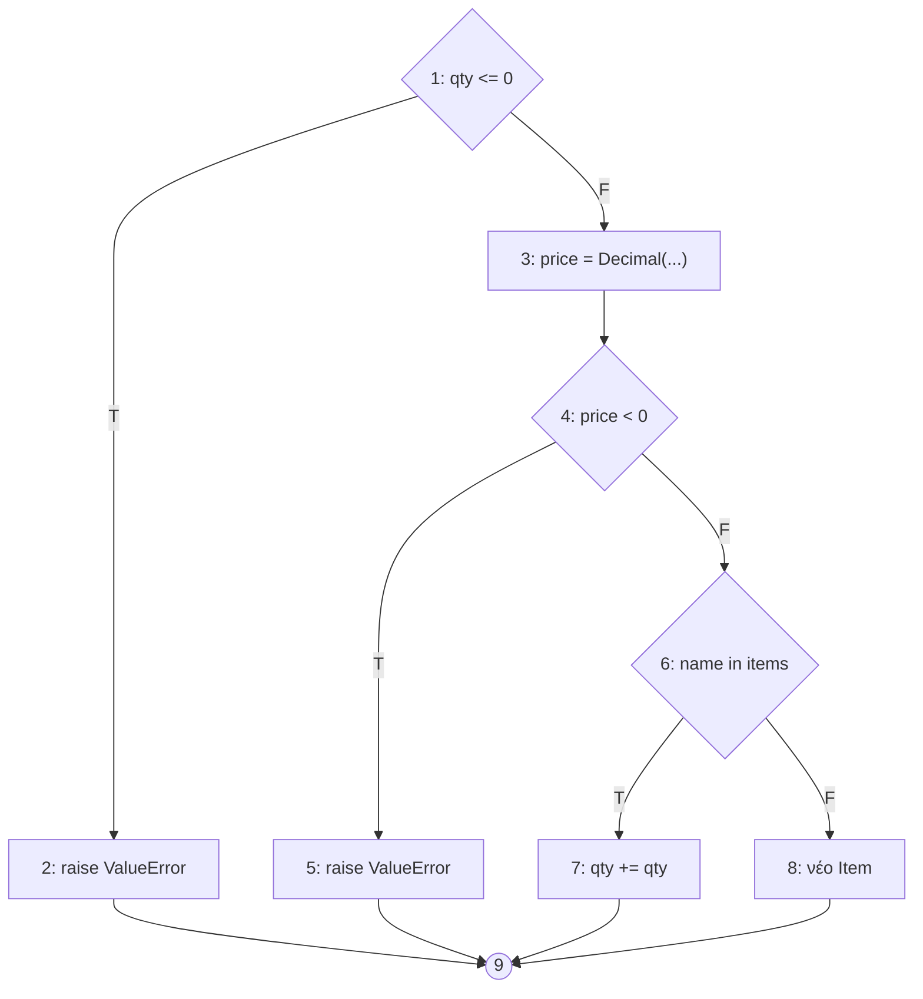

# Εβδομάδα 7 · Λυμένο παράδειγμα: προδιαγραφή ελέγχου white-box για το foodorder

Το λυμένο παράδειγμα δείχνει τη μορφή και το βάθος που περιμένουμε στην Εβδομάδα 7 του StudyRoom. Ακολουθεί το υπόδειγμα `templates/w07_test_specification_whitebox.md`, ενότητα προς ενότητα. Η βάση ελέγχου είναι οι απαιτήσεις FR-01 έως FR-13 του `labs/week02/SOLVED.md`. Τα tests είναι στο `labs/week07/test_whitebox_w07.py`, και όλες οι μετρήσεις προέρχονται από πραγματική εκτέλεση στο foodorder 0.1.0.

**Ομάδα:** λυμένο παράδειγμα · **Έκδοση:** w07 · **Κώδικας:** `foodorder/src/foodorder/cart.py`, `Cart.add` και `Cart.set_qty` · **Βάση ελέγχου:** FR-01, FR-02, FR-05

## 1. Αντικείμενο και στόχος κάλυψης

Πρώτα μετρήθηκε η κάλυψη με όσα tests υπάρχουν ήδη: τα 3 starter tests και τα 53 της Εβδομάδας 6.

```
$ python -m pytest --cov=foodorder --cov-report=term-missing
Name                          Stmts   Miss Branch BrPart  Cover   Missing
src/foodorder/cart.py            40      5     12      4    83%   31, 33, 40, 42, 49
src/foodorder/payments.py        27      1      4      1    94%   45
src/foodorder/pricing.py         28      1      8      1    94%   48
src/foodorder/restaurant.py      10      5      0      0    50%   10-12, 16-17
(τα checkout.py, orders.py και __init__.py στο 100%)
TOTAL                           182     12     34      6    92%
```

Το `cart.py` είναι το μόνο αρχείο με κενά που δεν οφείλονται σε ελεγξιμότητα (Ενότητα 8), και περιέχει τον κανόνα του υποσυνόλου, που μπαίνει σε κάθε τιμή του foodorder.

| Μονάδα | Γιατί επιλέχθηκε (κίνδυνος, πολυπλοκότητα) | Κριτήριο κάλυψης | Στόχος | Κάλυψη πριν |
|---|---|---|---|---|
| `Cart.add` | Κάθε τιμή του καλαθιού περνά από εδώ (FR-01, FR-05)· V(G) = 4 | Διακλαδώσεις, βασικά μονοπάτια | 100% | Χωρίς τις γραμμές 31, 33 |
| `Cart.set_qty` | Η αλλαγή ποσότητας αλλάζει το υποσύνολο (FR-01, FR-02)· V(G) = 4 | Διακλαδώσεις, βασικά μονοπάτια | 100% | Χωρίς τις γραμμές 40, 42 |

Δεν υπάρχουν σύνθετες συνθήκες, οπότε το MC/DC συμπίπτει με την κάλυψη διακλαδώσεων.

## 2. Γράφος ροής ελέγχου

### Cart.set_qty



| Κόμβος | Γραμμές κώδικα | Περιγραφή |
|---|---|---|
| 1 | 39 | `if name not in self._items` |
| 2 | 40 | `raise KeyError(name)` |
| 3 | 41 | `if qty < 0` |
| 4 | 42 | `raise ValueError(...)` |
| 5 | 43 | `if qty == 0` |
| 6 | 44 | `del self._items[name]` |
| 7 | 46 | `self._items[name].qty = qty` |
| 8 | — | έξοδος |

### Cart.add



Κόμβοι 1–8 στις γραμμές 27, 28, 29, 30, 31, 32, 33, 35 του `cart.py`· 9 η έξοδος.

## 3. Κυκλωματική πολυπλοκότητα

| Μονάδα | E − N + 2 | Αποφάσεις + 1 | radon | Διαφορά |
|---|---|---|---|---|
| `Cart.set_qty` | 10 − 8 + 2 = 4 | 3 + 1 = 4 | A (4) | Καμία |
| `Cart.add` | 11 − 9 + 2 = 4 | 3 + 1 = 4 | A (4) | Καμία |

Στο `Cart.add` ο κόμβος 3 (`Decimal(str(unit_price))`) μπορεί να σηκώσει `decimal.InvalidOperation` για τιμή που δεν είναι αριθμός. Ο γράφος δεν τον δείχνει ως απόφαση, γιατί δεν υπάρχει `try`. Η εξαίρεση φτάνει στον καλούντα, και η συμπεριφορά αυτή δεν ορίζεται από τη FR-05 (Ενότητα 8).

## 4. Βασικά μονοπάτια

### Cart.set_qty

| Μονοπάτι | Ακολουθία κόμβων | Εφικτό; | Είσοδοι | Αναμενόμενο (απαίτηση) | Test |
|---|---|---|---|---|---|
| S1 βασική γραμμή | 1-3-5-7-8 | Ναι | pizza 9,50 €, νέα ποσότητα 3 | Υποσύνολο 28,50 € (FR-01) | starter |
| S2 αντιστρέφει το 1 | 1-2-8 | Ναι | ποσότητα για προϊόν που δεν υπάρχει | **Καμία απαίτηση**· ερώτηση (Ενότητα 8) | TC-WB-04 |
| S3 αντιστρέφει το 3 | 1-3-4-8 | Ναι | pizza, ποσότητα −1 | Απόρριψη, ποσότητα αμετάβλητη (FR-05 κατ' αναλογία) | TC-WB-05 |
| S4 αντιστρέφει το 5 | 1-3-5-6-8 | Ναι | souvlaki, ποσότητα 0 | Το προϊόν αφαιρείται (FR-02) | starter |

### Cart.add

| Μονοπάτι | Ακολουθία κόμβων | Εφικτό; | Είσοδοι | Αναμενόμενο (απαίτηση) | Test |
|---|---|---|---|---|---|
| A1 βασική γραμμή | 1-3-4-6-8-9 | Ναι | νέο προϊόν 9,50 €, ποσότητα 1 | Μπαίνει στο καλάθι | Εβδομάδα 6 |
| A2 αντιστρέφει το 1 | 1-2-9 | Ναι | ποσότητα −1 | Απόρριψη (FR-05) | starter |
| A3 αντιστρέφει το 4 | 1-3-4-5-9 | Ναι | τιμή −0,01 | Απόρριψη, κενό καλάθι (FR-05) | TC-WB-01 |
| A4 αντιστρέφει το 6 | 1-3-4-6-7-9 | Ναι | pizza 9,50 € × 1 και ξανά × 2 | Μία γραμμή, υποσύνολο 28,50 € (FR-01) | TC-WB-02 |

Όλα τα μονοπάτια είναι εφικτά. Τα S2 και S3 τα έβαλε στο αρχείο μόνο ο δομικός έλεγχος. Ο έλεγχος της Εβδομάδας 6 δεν είχε τεχνική που να τα ζητά για το `set_qty`.

## 5. Σύνθετες συνθήκες

Οι δύο μονάδες δεν έχουν σύνθετες αποφάσεις. Στο υπόλοιπο foodorder η μόνη είναι η `17 <= now.hour <= 19` του `pricing.py`, που αναλύθηκε στη διάλεξη: τα ζεύγη MC/DC (ώρα 12, 18, 20) περνούν όλα, ενώ το ελάττωμα INC-01 της Εβδομάδας 6 βρίσκεται στις 19:00–19:59.

## 6. Δοκιμή βρόχων

Οι δύο μονάδες δεν έχουν βρόχους. Ο μόνος βρόχος του `cart.py` είναι στο `Cart.subtotal` (`sum` πάνω στα προϊόντα):

| Βρόχος | 0 επαναλήψεις | 1 | 2 | τυπικός | μέγιστος |
|---|---|---|---|---|---|
| `Cart.subtotal` | κενό καλάθι → 0,00 (TC-WB-08) | ένα προϊόν (TC-BB-01 κ.ά.) | δύο προϊόντα (TC-WB-07 πριν το remove) | — | Δεν ορίζεται μέγιστο πλήθος προϊόντων· ερώτηση |

## 7. Περιπτώσεις ελέγχου

| ID | Μονοπάτι / συνθήκη | Είσοδοι | Αναμενόμενο αποτέλεσμα | Απαίτηση |
|---|---|---|---|---|
| TC-WB-01 | A3 | `add("pizza", "-0.01", 1)` | ValueError, κενό καλάθι | FR-05 |
| TC-WB-02 | A4 | `add("pizza", "9.50", 1)`, `add("pizza", "9.50", 2)` | Μία γραμμή, 28,50 € | FR-01 |
| TC-WB-03 | Όριο του `price < 0` | `add("νερό", "0.00", 1)` | Δεκτό, 0,00 € | FR-05 |
| TC-WB-04 | S2 | `set_qty("souvlaki", 2)` σε καλάθι χωρίς souvlaki | KeyError (τρέχουσα συμπεριφορά), καλάθι αμετάβλητο | — |
| TC-WB-05 | S3 | `set_qty("pizza", -1)` | ValueError, υποσύνολο 19,00 € αμετάβλητο | FR-05 |
| TC-WB-06 | Όριο του `qty == 0` | `set_qty("pizza", 1)` | Μία γραμμή, 9,50 € | FR-01 |
| TC-WB-07 | `Cart.remove` | `remove("pizza")` | Υποσύνολο 1,00 € | — |
| TC-WB-08 | Βρόχος του subtotal, 0 επαναλήψεις | κενό καλάθι | 0,00 € | FR-01 |

Τα TC-WB-03 και TC-WB-06 δεν τα ζητά κανένα κριτήριο δομής. Προστέθηκαν γιατί κάθε σύγκριση του κώδικα ελέγχεται και στο όριό της, όπως στην Εβδομάδα 6.

## 8. Μετρημένη κάλυψη

```
$ python -m pytest --cov=foodorder --cov-report=term-missing
src/foodorder/cart.py            40      0     12      0   100%
src/foodorder/payments.py        27      1      4      1    94%   45
src/foodorder/pricing.py         28      1      8      1    94%   48
src/foodorder/restaurant.py      10      5      0      0    50%   10-12, 16-17
TOTAL                           182      7     34      2    96%
64 tests: 58 passed, 6 failed (τα INC-01 έως INC-03 της Εβδομάδας 6)
```

| Μονάδα | Κάλυψη πριν | Κάλυψη μετά | Μη καλυμμένες γραμμές | Ταξινόμηση και αιτιολόγηση |
|---|---|---|---|---|
| `cart.py` | 83% | 100% | — | — |
| `payments.py` | 94% | 94% | 45 | Κανόνας χωρίς test: επιστροφή χρημάτων για άγνωστη αναφορά πληρωμής. Συνδέεται με τη FR-12· προγραμματίζεται για την Εβδομάδα 9 |
| `pricing.py` | 94% | 94% | 48 (`now = datetime.now()`) | Πρόβλημα ελεγξιμότητας: η γραμμή εκτελείται μόνο όταν δεν δοθεί στιγμή, και τότε το αποτέλεσμα εξαρτάται από το ρολόι. NFR-04, R-07· Εβδομάδα 8 |
| `restaurant.py` | 50% | 50% | 10–12, 16–17 | Πρόβλημα ελεγξιμότητας: το `is_open` διαβάζει το ρολόι και δεν δέχεται στιγμή, ενώ ο constructor δεν καλείται από κανένα test γιατί ο έλεγχος της FR-07 έγινε με ψεύτικο εστιατόριο. Τα όρια 11:00 και 23:30 μένουν αδοκίμαστα· NFR-04, R-07 |

Δύο ευρήματα για την προδιαγραφή, από μονοπάτια χωρίς απαίτηση:

- **S2, `set_qty` για προϊόν που δεν υπάρχει.** Ο κώδικας σηκώνει `KeyError`. Καμία FR δεν λέει τι πρέπει να γίνει. Ερώτηση προς την επιχείρηση· μέχρι την απάντηση, το TC-WB-04 καταγράφει την τρέχουσα συμπεριφορά και είναι σημειωμένο ως test χαρακτηρισμού, όχι επαλήθευσης.
- **`Cart.remove`.** Καμία FR δεν το περιγράφει, και η αφαίρεση γίνεται ήδη με ποσότητα 0 (FR-02). Ερώτηση: χρειάζεται δεύτερος τρόπος αφαίρεσης;

**Πλήρης κάλυψη εντολών που δεν βρίσκει ελάττωμα.** Τα tests της διάλεξης δίνουν 100% κάλυψη εντολών και διακλαδώσεων στο `pricing.py`, ενώ τα INC-01 (happy hour) και INC-02 (όριο 15,00 €) μένουν. Τα βρίσκουν μόνο τα tests της Εβδομάδας 6 στα όρια.

Αποτυχίες της Εβδομάδας 7: καμία. Τα 6 tests που αποτυγχάνουν είναι της Εβδομάδας 6 και έχουν ήδη αναφορές INC-01 έως INC-03.

## 9. Σύγκριση με την Εβδομάδα 6

| Ελάττωμα ή ανωμαλία | w06 | w07 | Γιατί |
|---|---|---|---|
| INC-01 happy hour έως 19:59 | Ναι | Όχι | Ελάττωμα σε τελεστή σύγκρισης· η κάλυψη και το MC/DC πετυχαίνονται χωρίς τιμή στις 19:xx |
| INC-02 όριο 15,00 € | Ναι | Όχι | Ίδιος λόγος· ο γράφος δεν αλλάζει αν το `>` γίνει `>=` |
| INC-03 ακύρωση από «αποδεκτή» | Ναι | Όχι | Το ελάττωμα είναι στα δεδομένα (ποιες καταστάσεις επιτρέπουν ακύρωση), όχι στη δομή. Κανένα κριτήριο δομής δεν ζητά να δοκιμαστεί κάθε μέλος μιας λίστας· το ζητά ο πίνακας μη έγκυρων μεταβάσεων |
| `set_qty` για άγνωστο προϊόν χωρίς απαίτηση | Όχι | Ναι | Κανένας κανόνας δεν το περιγράφει, οπότε καμία τεχνική βάσει προδιαγραφής δεν το ζητά. Το έδειξε το μονοπάτι S2 |
| `Cart.remove` χωρίς απαίτηση | Όχι | Ναι | Ίδιος λόγος |
| Το ωράριο του εστιατορίου δεν ελέγχεται | Μερικώς (περιορισμός) | Ναι, με μέτρηση | Η κάλυψη 50% του `restaurant.py` το κάνει μετρήσιμο |

Ο δομικός έλεγχος δεν βρήκε κανένα ελάττωμα που δεν είχε βρεθεί ήδη. Βρήκε όμως **κώδικα χωρίς απαίτηση** και έκανε μετρήσιμα τα κενά ελεγξιμότητας. Αυτή είναι η τυπική συνεισφορά του όταν προηγείται καλός έλεγχος βάσει προδιαγραφής.
